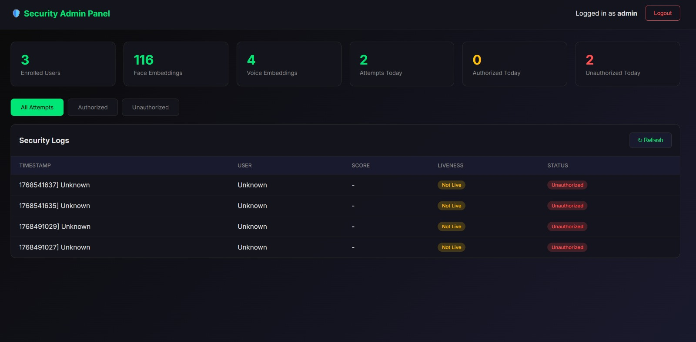
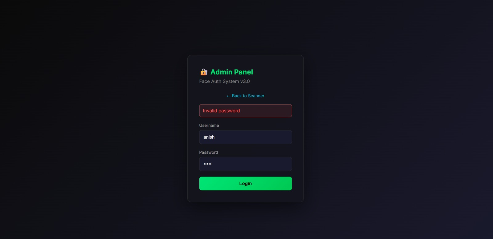

# COSMIC: Multimodal Biometric Authentication System v5.0

[](https://github.com/ans036/Face_auth_system/actions/workflows/ci.yml)
[](https://github.com/ans036/Face_auth_system/actions)
[](https://python.org)
[](https://fastapi.tiangolo.com)
[](https://docker.com)
[](LICENSE)
[](https://github.com/ans036/Face_auth_system)

A **research-driven multimodal biometric system** combining **Face Recognition**, **Voice Authentication**, **Liveness Detection**, and **Deepfake Detection**. The core fusion engine is **COSMIC** (**C**ategorical **O**ptimal-equilibrium **S**heaf-theoretic **M**ultimodal **I**dentity **C**orrespondence) -- a deep equilibrium model that computes provably optimal identity embeddings via a closed-form convex energy minimizer.

> **Research Highlights**:
> - **COSMIC (CGE)**: 6.0% EER / 98.1% AUC (449 identities, 6 datasets, 5-fold CV)
> - **MIMOP-FAME-CEBS**: 14.59% EER production fusion (beats FAME 2024 winner's 19.9%)
> - **Cross-Modal Retrieval**: R@5 = 29.4%, AUC = 81.2% on unseen identities from frozen backbones
> - **Ablation**: Removing CGE solver collapses EER from 8.7% to 31.4% -- the formulation is essential

---

## COSMIC Architecture

The identity embedding `I*` is defined as the **unique minimizer** of a strictly convex energy functional:

```
I* = argmin_I [ 1/2 I^T H I - b^T I ]  =  H^{-1} b   (closed-form, unique)
```

where `H` is provably positive definite by construction (eigenvalue range [18.6, 94.4], condition number 5.1).

```
┌────────────────────────────────────────────────────────────────────────────┐
│                    COSMIC FUSION ARCHITECTURE (v5.0)                       │
│      Categorical Optimal-equilibrium Sheaf-theoretic Fusion (CGE)          │
├────────────────────────────────────────────────────────────────────────────┤
│                                                                            │
│   FROZEN BACKBONES                                                         │
│   ┌──────────────────┐  ┌──────────────────┐  ┌──────────────────────┐    │
│   │  InsightFace      │  │  ECAPA-TDNN      │  │  Context Features    │    │
│   │  ArcFace (512D)   │  │  Voice  (192D)   │  │  eGeMAPS    (88D)   │    │
│   │  [frozen]         │  │  [frozen]        │  │  Prosody   (103D)   │    │
│   └────────┬─────────┘  └────────┬─────────┘  │  Face AU    (27D)   │    │
│            │                      │            └──────────┬───────────┘    │
│            ▼                      ▼                       ▼                │
│   ┌────────────────────────────────────────────────────────────────┐       │
│   │              KA-SPLINE PROJECTIONS (Kolmogorov-Arnold)         │       │
│   │   face_h = KASpline(512 -> hidden)                            │       │
│   │   voice_h = KASpline(192 -> hidden)                           │       │
│   └────────┬──────────────────────┬───────────────────────────────┘       │
│            │                      │                       │                │
│            │                      │                       ▼                │
│            │                      │            ┌──────────────────────┐    │
│            │                      │            │  VIB Context Bottleneck│   │
│            │                      │            │  218D -> mu,sigma    │    │
│            │                      │            │  z ~ N(mu, sigma^2)  │    │
│            │                      │            │  -> 64D (disentangled)│   │
│            │                      │            │  KL(q||p) penalty    │    │
│            │                      │            └──────────┬───────────┘    │
│            │                      │                       │                │
│   ┌────────▼──────────────────────▼───────────────────────▼────────┐       │
│   │         CATEGORICAL KAN EXTENSION FUSION                       │       │
│   │                                                                │       │
│   │   6 Cross-Modal Morphisms: phi_fv, phi_vf, phi_fc, phi_cf,   │       │
│   │                            phi_vc, phi_cv                      │       │
│   │                                                                │       │
│   │   Equalizer Violation: C = sum ||phi_ij(m_i) - m_j||^2       │       │
│   │   (enforces cross-modal coherence via categorical limit)       │       │
│   │                                                                │       │
│   │   f_kan = Perceiver cross-attention fusion target              │       │
│   └────────────────────────────┬───────────────────────────────────┘       │
│                                │                                           │
│   ┌────────────────────────────▼───────────────────────────────────┐       │
│   │         CONVEX ENERGY CGE SOLVER                               │       │
│   │                                                                │       │
│   │   H = W^T W + beta^2 rho_f^T rho_f                           │       │
│   │                + gamma^2 rho_v^T rho_v + epsilon I             │       │
│   │                                                                │       │
│   │   b = alpha * f_kan + beta^2 * rho_f^T * h_f                 │       │
│   │                     + gamma^2 * rho_v^T * h_v                 │       │
│   │                                                                │       │
│   │   I* = H^{-1} b    (unique global minimum, closed-form)       │       │
│   │   I* = I* / ||I*||  (projected to unit sphere S^63)           │       │
│   │                                                                │       │
│   │   Effective rank: 62.1/64 | H cond number: 5.1               │       │
│   └────────────────────────────┬───────────────────────────────────┘       │
│                                │                                           │
│   ┌────────────────────────────▼───────────────────────────────────┐       │
│   │   9-TASK DB-MTL TRAINING (Dynamic Barrier Multi-Task Learning) │       │
│   │                                                                │       │
│   │   1. CGE convergence    4. Angular (ArcFace)  7. Integrated    │       │
│   │   2. Sheaf (H0+H1)     5. Metric (triplet)   8. Coherence     │       │
│   │   3. Persistent homol.  6. Regularization     9. SNFC          │       │
│   │                                                                │       │
│   │   + Conflict-Averse Gradients [CAGrad] + Kendall weighting    │       │
│   └────────────────────────────────────────────────────────────────┘       │
│                                                                            │
│   COMPACT VARIANT (compact=True):                                          │
│   Strips morphisms, sheaf, persistent cohomology, SNFC.                   │
│   Retains: CGE solver, KA-Spline, VIB, cross-attention, angular, metric. │
│   6 tasks instead of 9. Used for extended multi-dataset evaluation.        │
└────────────────────────────────────────────────────────────────────────────┘
```

### SNFC Module (Sheaf-Normalized Fisher Coherence)

The SNFC module addresses morphism mean-collapse where MSE-trained morphisms predict population centroids instead of per-identity targets. It uses:
- **Z-score normalization** per morphism for heterogeneous scale alignment
- **Cosine contrastive loss** (margin=0.1) that pushes `phi_fv(face_A)` toward `voice_A` and away from `voice_B`
- **Fisher ratio monitoring** for real-time discriminability tracking (Fisher v_fv: 0.0016 -> 1.10, a 695x improvement)

---

## Production Pipeline

```
┌─────────────────────────────────────────────────────────────────────────┐
│                  PRODUCTION CASCADED PIPELINE                           │
├─────────────────────────────────────────────────────────────────────────┤
│                                                                         │
│  STAGE 0: LIVENESS GATE (ViT-DINO + MediaPipe EAR + Frequency)        │
│           vit_liveness.onnx  |  9.66ms  |  85.9% accuracy              │
│           [SPOOF?] --> REJECT                                           │
│                                                                         │
│  STAGE 1: DEEPFAKE GATE (Frequency + Texture Consistency)              │
│           deepfake_detector.onnx  |  10.47ms  |  85.9% val acc         │
│           [FAKE?] --> REJECT                                            │
│                                                                         │
│  STAGE 2: EMBEDDING EXTRACTION                                          │
│           InsightFace ArcFace (512D)  +  ECAPA-TDNN (192D)             │
│                                                                         │
│  STAGE 3: MIMOP-FAME-CEBS FUSION (14.59% EER)                         │
│           ┌─────────────┐  ┌──────────────┐  ┌───────────────────┐     │
│           │  Face Only   │  │  Voice Only  │  │  Face + Voice     │     │
│           │  (6.8 MB)    │  │  (6.5 MB)   │  │  (10.1 MB)        │     │
│           │  ONNX        │  │  ONNX       │  │  ONNX             │     │
│           └──────────────┘  └──────────────┘  └───────────────────┘     │
│           MIMOP: HSIC identity disentanglement                          │
│           CEBS-DART: Dempster-Shafer evidential belief fusion           │
│                                                                         │
│  STAGE 4: CONFIDENCE GATE                                               │
│           40% < confidence < 60% --> LLM Cognitive Challenge            │
│           (Groq LLaMA-3.1 for complex answer verification)             │
│                                                                         │
│  OUTPUT:  GRANTED  |  DENIED  |  REQUIRE 2FA                           │
└─────────────────────────────────────────────────────────────────────────┘
```

---

## Key Results

### COSMIC (Research - 5-Fold Identity-Disjoint CV)

| Configuration | Identities | Datasets | EER (%) | AUC (%) |
|---------------|:----------:|:--------:|:-------:|:-------:|
| **Full COSMIC** | 200 | MAV-Celeb | **8.8 +/- 0.9** | **96.8 +/- 0.7** |
| **Compact + Extended** | 449 | 6 datasets | **6.0 +/- 0.6** | **98.1 +/- 0.2** |
| Zero-shot CREMA-D | 91 | CREMA-D | **5.6 +/- 0.5** | **98.8 +/- 0.2** |

### Ablation Study (3-Fold CV, MAV-Celeb)

| Variant | EER (%) | AUC (%) | Params |
|---------|:-------:|:-------:|:------:|
| B1-ConcatMLP | 38.1 +/- 2.1 | 67.1 +/- 2.7 | ~327K |
| B2-ScoreFusion | 17.7 +/- 0.6 | 90.4 +/- 0.7 | ~199K |
| B3-CrossAttention | 25.1 +/- 1.6 | 82.6 +/- 1.7 | ~317K |
| A2-NoDEQ (COSMIC w/o CGE) | 31.4 +/- 2.2 | 75.3 +/- 2.5 | ~1.1M |
| **A1-Full COSMIC** | **8.7 +/- 0.1** | **96.9 +/- 0.1** | **~1.1M** |

> Removing the CGE solver collapses EER from 8.7% to 31.4%, confirming the convex energy formulation is essential.

### Cross-Modal Retrieval (Unseen Identities)

| Metric | Value |
|--------|:-----:|
| Face-to-Voice R@5 | 29.4% |
| Face-to-Voice R@10 | 51.3% |
| Cross-Modal AUC | 81.2% |
| Chance R@5 (90 IDs) | 5.6% |

### MIMOP-FAME-CEBS (Production - ONNX)

| Component | Latency | EER |
|-----------|:-------:|:---:|
| MIMOP Authenticator | 2.78 ms | **14.59%** |
| ViT Liveness | 9.66 ms | - |
| Deepfake Detector | 10.47 ms | - |
| **Full Pipeline** | **~24 ms** | - |

> MIMOP-FAME-CEBS beats the FAME 2024 challenge winner (19.9% EER) by 26.6% relative improvement.

---

## Trained Models

| Model | Dataset | Size | Metric | Purpose |
|-------|---------|:----:|:------:|---------|
| `cosmic_v4_identity_free_*.pt` | 6 datasets (449 IDs) | ~1.2M params | 6.0% EER | COSMIC CGE research (5 folds) |
| `compact_cosmic_mavceleb_only_best.pt` | MAV-Celeb | ~0.8M params | 8.8% EER | Compact variant |
| `mimop_fame_cebs_fused.onnx` | MAV-Celeb v3 | 10.1 MB | 14.59% EER | Face+Voice ONNX production |
| `mimop_fame_cebs_face_only.onnx` | MAV-Celeb v3 | 6.8 MB | - | Face-only ONNX |
| `mimop_fame_cebs_voice_only.onnx` | MAV-Celeb v3 | 6.5 MB | - | Voice-only ONNX |
| `cebs_darts_best.pt` | MAV-Celeb | - | - | CEBS-DARTS architecture search |
| `edisc_mimop_cebs_final.pt` | MAV-Celeb | - | - | EDISC-MIMOP-CEBS fusion |
| `vit_liveness.onnx` | CelebA-Spoof | ~50 MB | 85.9% acc | Spatial liveness gate |
| `deepfake_detector.onnx` | FaceForensics++ | ~40 MB | 85.9% val | Deepfake detection gate |

---

## [VIDEO] System Demo

### Face-Gated Secure Messages


### Live Scanner Action


### [PC] Admin Dashboard
<p float="left">
  
  
  
  
</p>

---

## Project Structure

```
backend/
  core/
    cosmic_sota_v3.py          # COSMIC V3 - primary model (9 DB-MTL tasks, SNFC, CGE)
    cosmic_sota.py             # COSMIC V1 baseline
    cosmic_authenticator.py    # Production wrapper with audit trail
    cosmic_losses.py           # Loss functions
    detector.py                # InsightFace face detection (buffalo_l)
    embedder.py                # Face embeddings (ArcFace, 512D)
    voice_embedder.py          # Voice embeddings (ECAPA-TDNN, 192D)
    recognizer.py              # Face recognition pipeline
    liveness.py                # Liveness detection
    deepfake_spatial.py        # Spatial deepfake features
    deepfake_temporal.py       # Temporal deepfake features
    context_disentanglement.py # LEACE/SPLICE/ConditionalLEACE, GeneralizableXMAligner
    mimop_fame_cebs_authenticator.py  # MIMOP-FAME-CEBS production fusion
    ...
  api/
    authenticate.py            # Main authentication endpoint
    enroll.py                  # Face/voice enrollment
    identify.py                # Face identification
    gallery.py                 # Gallery management
    admin.py                   # Admin dashboard
    ...
  db/
    models.py                  # SQLAlchemy ORM (PostgreSQL + pgvector)
    session.py                 # Database session management
    crud.py                    # CRUD operations
  scripts/
    train_cosmic_unified.py          # UnifiedCOSMICClassifier training
    train_cosmic_continuous.py       # COSMIC continuous training (5-fold)
    train_cosmic_lite.py             # Minimal reproducible variant
    run_comprehensive_ablation.py    # Full ablation suite (A1-A7, B1-B4)
    run_ablation_study.py            # Ablation runner
    evaluate_checkpoint.py           # Deterministic evaluation
    extract_all_features_v2.py       # Feature extraction pipeline
    finetune_cosmic_v3_local.py      # Local fine-tuning
    build_gallery.py                 # Gallery builder
    benchmark.py                     # Performance benchmarks
    biometric_evaluation.py          # FAR/FRR/EER evaluation
    convert_to_onnx.py              # PyTorch -> ONNX conversion
    train_cebs_darts.py             # CEBS-DARTS NAS training
    train_edisc_mimop.py            # EDISC-MIMOP training
    ...

  tests/                       # 158+ tests (pytest)

frontend-next/                 # Next.js React frontend
config/thresholds.yaml         # Threshold configuration
COSMIC/                        # COSMIC research docs & visualizations
models/                        # Trained model checkpoints
database/                      # Enrollment images & training datasets
```

---

## Scientific Foundations

### COSMIC (Research Core)

| Component | Reference | Role |
|-----------|-----------|------|
| **CGE Solver (Convex Global Equilibrium)** | Bai et al. NeurIPS 2019 | Identity as unique minimizer of convex energy; closed-form I* = H^{-1}b with provable optimality |
| **Categorical Kan Extension** | Mac Lane 1971; Shiebler 2022 | Cross-modal fusion via right Kan extension; 6 morphisms enforce categorical coherence |
| **KA-Spline Projections** | Kolmogorov-Arnold representation | Learnable spline-based input projections replacing linear layers |
| **VIB Context Bottleneck** | Alemi et al. ICLR 2017 | Variational Information Bottleneck strips identity from context (14.7% probe acc) |
| **SNFC** | Novel | Sheaf-Normalized Fisher Coherence: cosine contrastive morphism training + Fisher monitoring |
| **DB-MTL** | Liu et al. ICLR 2021 | Dynamic Barrier Multi-Task Learning for 9-task loss balancing |
| **CAGrad** | Liu et al. NeurIPS 2021 | Conflict-Averse Gradient Descent for multi-task optimization |
| **ConditionalLEACE** | Ravfogel et al. ICML 2022 | Within-identity nuisance erasure for cross-modal projection |

### MIMOP-FAME-CEBS (Production Fusion)

| Component | Reference | Role |
|-----------|-----------|------|
| **MIMOP** | Gretton et al. 2005 | HSIC-based identity-modality orthogonal projection |
| **FAME 2024** | ACM MM 2024 Challenge | Multi-similarity + cross-modal contrastive |
| **CEBS-DART** | Novel | Confidence-based Evidential Belief + Dempster-Shafer uncertainty |
| **SPOS** | Guo et al. 2020 | Single-path NAS avoiding DARTS Matthew Effect |

---

## Key Features

### Multi-Modal Security
- **Face Recognition**: InsightFace ArcFace ResNet-100 (512D embeddings, frozen backbone)
- **Voice Authentication**: SpeechBrain ECAPA-TDNN (192D embeddings, frozen backbone)
- **Context Features**: eGeMAPS (88D) + Prosody (103D) + Face AU/Pose/Gaze (27D)
- **Liveness Detection**: ViT-DINO spatial + MediaPipe EAR blink + Frequency/texture analysis
- **Deepfake Detection**: Frequency domain GAN fingerprinting + texture consistency

### Scalable Architecture
- **PostgreSQL + pgvector**: HNSW-indexed vector similarity search
- **ONNX Runtime**: GPU-accelerated inference (~24ms full pipeline)
- **Docker Compose**: Full-stack containerized deployment
- **Rate Limiting**: IP-based throttling with exponential backoff

---

## Tech Stack

| Component | Technology |
|-----------|------------|
| **Research Model** | COSMIC with CGE Solver (PyTorch, ~1.2M params) |
| **Production Fusion** | MIMOP-FAME-CEBS (ONNX Runtime) |
| **Face Backbone** | InsightFace ArcFace ResNet-100 |
| **Voice Backbone** | SpeechBrain ECAPA-TDNN |
| **Backend** | FastAPI + SQLAlchemy (Async) |
| **Database** | PostgreSQL + pgvector (HNSW) / SQLite fallback |
| **Frontend** | Next.js (React + TypeScript + Tailwind) |
| **Container** | Docker Compose |
| **Security** | Bcrypt, Rate Limiting, Session Tokens |

---

## API Endpoints

| Endpoint | Method | Description |
|----------|--------|-------------|
| `/identify/` | POST | Multi-modal identification (Rate Limited) |
| `/admin/login` | POST | Secure admin login (Bcrypt) |
| `/admin/logs` | GET | Retrieve security logs |
| `/admin/stats` | GET | System statistics |
| `/enroll/` | POST | Enroll new users/voices |
| `/gallery/rebuild` | POST | Rebuild embeddings gallery |

---

## Getting Started

### 1. Prerequisites
- **Docker Desktop** (WSL2 backend recommended)
- **Git LFS** (for large model files)
- **NVIDIA GPU** with CUDA 11.8+ (for training; inference works on CPU)

### 2. Setup Database
Place user images in `database/<username>/` and voice samples (optional) in `database/<username>/voice/`.

### 3. Deploy
```bash
docker compose up --build
```

### 4. Access
- **Live Scanner**: http://localhost:3000
- **Admin Panel**: http://localhost:3000/admin
- **API Docs**: http://localhost:8001/docs

### 5. Reproduce COSMIC Results
```bash
# Extract features (cached in backend/cache/all_features_v2.pkl)
python backend/scripts/extract_all_features_v2.py

# Train full COSMIC V3 (5-fold, ~2h/fold on RTX 4060)
python -u backend/scripts/train_cosmic_continuous.py

# Run ablation study (A1-A7, B1-B4)
python -u backend/scripts/run_ablation_study.py --variants all --folds 3 --epochs 80
```

---

## Embedding Health Properties

| Property | Value | Significance |
|----------|:-----:|-------------|
| Effective rank | 62.1 / 64 | Near-full dimensional utilization, no collapse |
| H condition number | 5.1 | Well-conditioned Hessian |
| H eigenvalue range | [18.6, 94.4] | Strict convexity confirmed |
| VIB active dims | 64 / 64 | All bottleneck dimensions utilized |
| Context -> Identity probe | 14.7% | Context successfully disentangled from identity |
| Identity -> Identity probe | 100.0% | Identity signal fully preserved |

---

## Challenges & Solutions

### 1. Morphism Mean-Collapse
**Problem**: MSE-trained cross-modal morphisms predict population centroids (conditional mean), not per-identity targets. Output variance ratio = 0.44 (<<1).
**Solution**: SNFC module with cosine contrastive loss. Fisher ratio improved 695x (0.0016 -> 1.10), attack classification 47% -> 81.8%.

### 2. Cross-Modal Overfitting
**Problem**: InfoNCE on 300 train IDs gives Train R1=89.8% but Val R1=1.0% -- massive overfitting.
**Solution**: GeneralizableXMAligner with MSE centroid alignment + VICReg + OPL. Replaced O(n^2) contrastive with O(n*d) losses.

### 3. Coherence Gradient Takeover
**Problem**: Coherence MSE hinge dominates morphism gradients (93% by epoch 5), drowning SNFC signal.
**Solution**: Wrapped impostor violation computations in `torch.no_grad()`. Only SNFC's cosine contrastive loss trains morphisms.

### 4. Tensor Shape Mismatches in Fusion
**Problem**: SpeechBrain returns `[1,1,192]` while InsightFace returns `(512,)`, causing silent broadcasting errors.
**Solution**: Strict tensor normalization decorator enforcing shape consistency before fusion.

### 5. Cold Start Latency
**Problem**: First inference request takes ~4s (lazy CUDA initialization).
**Solution**: Model warmup routine during container startup lifecycle event.

---

## Configuration

| Setting | Value | Description |
|---------|-------|-------------|
| **DB Backend** | PostgreSQL | Auto-fallback to SQLite |
| **Face Weight** | 0.85 | Primary biometric factor |
| **Voice Weight** | 0.15 | Secondary factor |
| **Rate Limit** | 120/min | Per-IP throttling |
| **Liveness** | Blink | Required for "Live" status |

---

## Testing

```bash
docker compose run --rm backend pytest tests/ -v
# 158+ tests covering biometrics, enrollment, gallery, admin, liveness, deepfake detection
```

---

## License

MIT License
